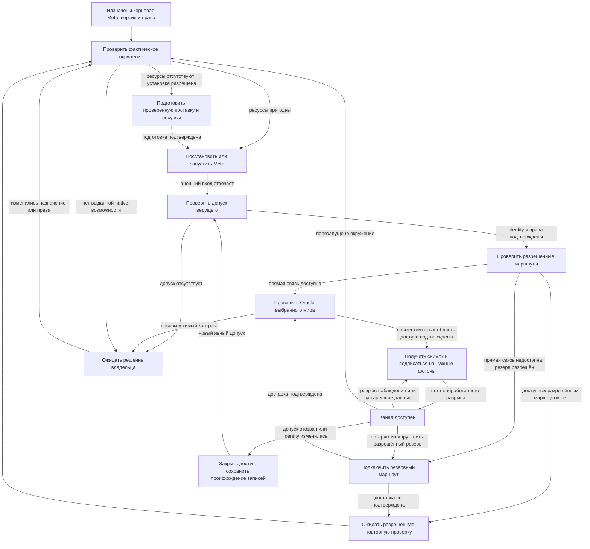

# Окружения и связь Вселенных

Окружение разворачивается собственной корневой Meta. В принятой связке
настольный Mac является ведущим: он назначает состав, версии и права ведомых.
Codespaces, отдельные VPN-окружения и удалённые устройства являются ведомыми.
Они самостоятельно исполняют назначенную Meta и сохраняют собственные Boundary,
Mass и причинную историю. Эти отношения сохраняют
[identity и происхождение данных каждого мира](ARCHITECTURE.md#единое-пространство-нескольких-миров).

Документ задаёт принятый контракт окружений. Степень его реализации и живая
приёмка отслеживаются в [плане Oracle Environment](ORACLE_ENVIRONMENT_PLAN.md).

## Развёртывание

Установщик получает проверенную поставку и выбранную корневую Meta. После
рождения Quantum её Atom через Processes и actions подготавливают хранилища,
запускают назначенные ресурсы и обеспечивают разрешённый внешний вход.
Установщик не становится вторым управляющим автоматом рядом с Meta.

Корень `workspace-capsule` управляет рабочим пространством с Capsule.
Корень `intel-macos-chrome-studio` управляет Chrome Studio на Intel Mac.
Другой тип устройства требует совместимой корневой Meta и подтверждённых
native-возможностей. Наличие названия платформы в каталоге не подтверждает
возможность её установки или исполнения.

Provider является Meta, предоставляющей назначенные возможности окружения.
Он управляет разрешённым развёртыванием, регистрирует участников и доступные
исполнители в своей Mass. Модельный провайдер является одним из случаев
[этого управления и наблюдения](../standard/provider/README.md).
Сеть, проверка ресурсов и восстановление исполняются автоматами без ИИ.
Агенты подключаются явно; их отсутствие не останавливает окружение.

Текущий этап использует серверную Energy. Браузер предоставляет интерфейс
и WebRTC-представления. Браузерная Energy относится к следующему этапу PWA.

## Цель канала

Канал готов, когда одновременно подтверждены:

- назначенное окружение запущено и предоставляет свой внешний вход;
- ведущий допустил точную identity ведомого и назначил область доступа;
- доступен разрешённый маршрут до этого ведомого;
- Oracle подтвердил identity мира, совместимость и назначенные операции;
- получен допустимый исходный снимок и установлено наблюдение нужных Atom;
- наблюдение не имеет необработанного разрыва и сохраняет актуальность.

Готовность браузерного исполнителя проверяется отдельно: живой канал до
Вселенной не доказывает, что её браузер запущен, профиль открыт или сервис
готов принять сообщение. Вход в аккаунт и управление браузером выполняются
через WebRTC-представление Provider в дисплее агента.

## Граф достижимости

Каждый переход проверяет значения, подтверждённые своим владельцем.
Неизвестное наблюдение сохраняется как неизвестное. Успех команды запуска
подтверждает только принятый или завершённый шаг этой команды.

Таймаут не превращается в отрицательный результат внешнего действия.
Если действие могло быть принято, автомат сначала наблюдает его исход по
сохранённой identity. Повторная отправка разрешена только по контракту
владельца операции. Чтения могут повторяться в пределах назначенной политики.

| Наблюдение | Следующий допустимый шаг |
| --- | --- |
| Ресурс не установлен | Разрешённая установка выбранной версии |
| Ресурс остановлен | Запуск существующего ресурса с сохранением данных |
| Запуск ещё выполняется | Наблюдение того же запроса |
| Исход запуска неизвестен | Проверка того же запроса без повторного эффекта |
| Доступ отозван | Закрытие назначенных каналов |
| Доступен прямой маршрут | Проверка Oracle по этому маршруту |
| Прямой маршрут потерян | Проверка явно разрешённого резерва |
| Контракт или identity не совпали | Отказ продолжения и решение владельца |
| Пропущено наблюдение | Пометка неактуальности и восстановление через Oracle |
| Браузер или профиль не готовы | Отдельное восстановление ресурса; канал мира остаётся самостоятельным |

## Связь на уровне Atom

Oracle и Force связываются через одно назначенное отношение между Atom миров.
Отношение сохраняет identity обоих миров, выбранные Atom, допуск и область
наблюдения. Адрес Atom имеет смысл в контексте его Вселенной; совпадение
локального ref у двух миров не объединяет эти сущности.

Через Oracle проходят разрешённые вопросы и намерения. Через Force поступают
необходимые фотоны исходного мира. Их происхождение и порядок сохраняются;
повторное получение не становится новым фактом исходного мира. Разрыв потока
закрывает утверждение об актуальности до восстановления наблюдения.
Изменение каждого мира проходит его собственный
[причинный путь и Boundary commit](FORCE.md#единый-particle-path).

Provider наблюдает собственный Graph и допущенные удалённые Вселенные.
Он проверяет состояния, значения и объявленные возможности Atom
`chrome-studio` и `capsule`, сохраняя их владельцев. Реестр в Mass содержит
состав, происхождение, назначения и результаты проверок. Отключение сохраняет
запись и меняет её доступность; устаревшая проверка не выдаётся за текущую.

`useAtom` предоставляет представлению назначенный Atom, разрешённое чтение
Mass и действия через Oracle. Источник обновлений представления назначает
адаптер наблюдения; подписка на Force выдаётся как отдельная возможность.
Cosmos показывает тот же реестр и состояние; отдельной истины о провайдерах
в интерфейсе нет.

## Проверенный вариант и новый пир

Рабочий вариант изменяется и проверяется в Boundary и Mass. Явный commit
выбирает проверенную версию и публикует её у владельца файлового пакета по
[принятому порядку авторинга](META_PACKAGES.md#принятый-порядок-рабочего-авторинга).
Новая поставка позволяет другому пиру начать с этой версии с нулевой точки.
Перенос истории, профилей и пользовательских данных является отдельным
разрешённым действием и не следует автоматически из установки кода.
